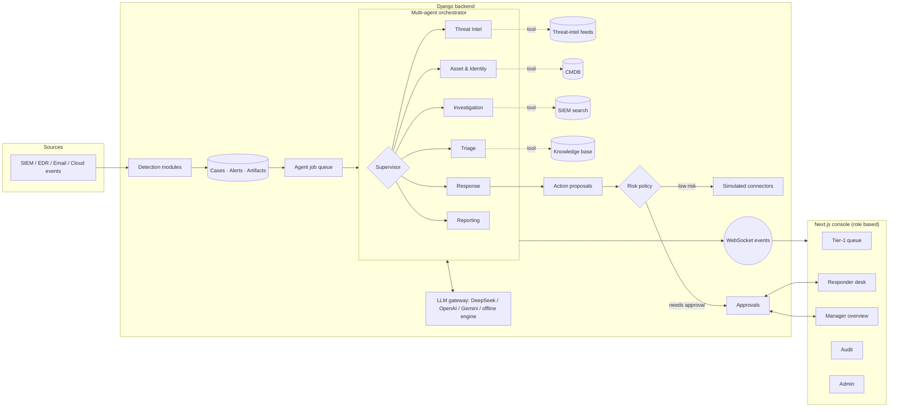

# NEXUS-SOC: a multi-agent Security Operations Center

A Security Operations Center in which a **team of AI agents** investigates every alert
end to end, and **human analysts stay in control** through a role-based console.

- **7 cooperating agents.** A Supervisor routes each case through Triage, Threat Intel,
  Asset & Identity, Investigation, Response and Reporting specialists.
- **Human in the loop.** Agents only *propose* containment actions. Policy sets the risk
  tier, and Medium/High/Critical actions wait for a Tier-2 Responder or the SOC Manager.
- **5 roles:** SOC Admin, SOC Manager, Tier-1 Analyst, Tier-2 Incident Responder and
  Auditor. Each role has its own home page and permissions, enforced on every API endpoint.
- **Runs anywhere.** Use DeepSeek, OpenAI or Google Gemini, or the **built-in offline
  engine** with no internet or API key. In *Auto* mode it falls back to offline when the
  LLM is unreachable.
- **Fully auditable.** Every routing decision, tool call, model, token count and approval
  is stored and shown in the Decision Trail and the Audit Log.

---

## Architecture



### How one case flows

1. A raw event reaches a **detection module**, which creates or correlates a case, its alerts and artifacts.
2. The **Supervisor** reads the shared case state and picks the next specialist. The LLM
   chooses the route, and **guardrails** reject illegal moves (for example, a response before
   any investigation). When Triage is confident the case is a false positive, the team skips
   straight to the report.
3. Each **specialist** calls its tools (threat intel, CMDB, log search, knowledge base) and then
   reasons to a **typed output**: the LLM must fill a Pydantic schema, or the offline engine
   produces the same schema with rules.
4. The **Response Agent** proposes actions from a fixed catalogue. The **risk tier comes from
   policy, not the LLM**, and is raised one level for business-critical assets.
5. The **Reporting Agent** writes the verdict, an executive summary and a technical report.
   Confirmed High/Critical incidents are **auto-escalated** to the Tier-2 queue.
6. Every step streams live to the console over WebSocket.

## Roles

| Role | Home page | Highlights |
|---|---|---|
| Tier-1 Analyst | My Queue | AI-triaged queue, false positives filtered, escalate to Tier-2 |
| Tier-2 Incident Responder | Responder Desk | Escalated incidents, approve/reject Medium-High actions, resolve cases |
| SOC Manager | SOC Overview | KPIs (MTTR, AI/analyst agreement), workload, approve Critical actions |
| Auditor | Audit Log | Read-only: every change by people and agents, decision trail |
| SOC Admin | Admin Console | Users & roles, LLM providers, agent runtime mode |

Every home page opens with the same **SOC posture** charts: cases per day by severity
(14 days), open cases by severity, the case pipeline, a MITRE ATT&CK tactic × severity
heatmap, alerts by source and mean time to resolve.

## Quick start (Docker)

```bash
cp .env.example .env          # optionally add DEEPSEEK_API_KEY=...
docker compose up -d --build
```

Open **http://localhost:3000** and sign in as one of the demo personas
(password `SocDemo@2026`):

| Username | Persona | Role |
|---|---|---|
| `analyst` | Rohan Verma | Tier-1 Analyst |
| `responder` | Ananya Iyer | Tier-2 Incident Responder |
| `manager` | Priya Sharma | SOC Manager |
| `auditor` | Vikram Nair | Auditor |
| `admin` | Aarav Mehta | SOC Admin |

On first start the stack seeds **two weeks of realistic history**: about 50 cases processed by
the agent team and worked by analysts. Use **Launch attack scenario** to generate a live incident.

## Local development (Windows)

Requirements: Python 3.14 + [uv](https://docs.astral.sh/uv/), Node.js 24, Docker Desktop.

```powershell
powershell -ExecutionPolicy Bypass -File scripts\start-dev.ps1          # start everything
powershell -ExecutionPolicy Bypass -File scripts\start-dev.ps1 -Seed    # rebuild demo history
```

| Service | URL |
|---|---|
| Console (Next.js) | http://localhost:3000 |
| API + WebSocket (Django/Channels) | http://localhost:8000 |
| API docs (OpenAPI) | http://localhost:8000/api/docs/ |

Useful commands (run from `backend/`):

```bash
python manage.py seed_demo --reset        # fresh 14-day demo history
python manage.py seed_demo_users          # (re)create the five demo accounts
python manage.py test                     # backend test suite
```

## Documentation

- [System design and architecture](docs/ARCHITECTURE.md): diagrams for every component, the detection rule catalogue, agent routing, data model, deployment, configuration and the runbook
- [Demo script](docs/DEMO_SCRIPT.md)

## Live log detection

`python manage.py run_live_detection` watches logs as they are written and opens a case the
moment an attack shows up. The AI agent team then investigates it automatically.

| Source | How |
|---|---|
| **Syslog** (UDP + TCP, RFC 3164/5424) | Point rsyslog, syslog-ng, firewalls or routers at `<host>:5514` |
| **Log files** | `--tail /var/log/auth.log --tail "/var/log/nginx/*.log"` or `LIVE_TAIL_FILES` (plain syslog, nginx/Apache access logs, JSON lines) |
| **Windows Event Log** | On by default on Windows: Security, System, PowerShell and Defender logs. Run as Administrator to read Security. |

There are 28 rules, each mapped to MITRE ATT&CK (`run_live_detection --list-rules`):
- **Linux**: SSH brute force, and a successful login from a brute-forcing IP
- **Accounts**: sudo failures, new accounts, users added to privileged groups
- **Network**: firewall port scans
- **Web attacks**: SQL injection, XSS, path traversal, command injection/Log4Shell, attack tools, directory brute force
- **Windows**: logon brute force and the logon that follows it, new users, admin group changes, audit log cleared, new services, scheduled tasks, Defender malware
- **Suspicious commands**: reverse shells, download-and-execute, encoded PowerShell, shadow copy deletion, credential dumping, LOLBins, log tampering, disabling security tools

Threshold rules use sliding windows. Repeat alerts are suppressed for `LIVE_DETECTION_COOLDOWN_SECONDS`,
and repeats within 24 h join the same case.

Try it locally (PowerShell):

```powershell
$udp = New-Object System.Net.Sockets.UdpClient
1..6 | % { $b = [Text.Encoding]::ASCII.GetBytes("<38>Nov  3 10:00:0$_ web-01 sshd[1]: Failed password for root from 185.220.101.47 port 4000$_ ssh2"); [void]$udp.Send($b, $b.Length, "127.0.0.1", 5514) }
```

## Alert emails

When the agent team finishes a case with a verdict in `ALERT_EMAIL_VERDICTS` (default: True
Positive, Suspicious) at or above `ALERT_EMAIL_MIN_SEVERITY` (default: High), NEXUS-SOC emails
`ALERT_EMAIL_TO`. The email contains:
- the verdict, severity and MITRE mapping
- the AI summary
- affected assets and indicators of compromise
- recommended actions
- a link to the case

Each case is emailed once per verdict, and again only if its severity rises. Every attempt is
logged in `notification_logs`.

Gmail setup in `backend/.env`:

1. Turn on 2-Step Verification and create an [App Password](https://myaccount.google.com/apppasswords).
2. Set the SMTP settings:
   ```
   EMAIL_HOST=smtp.gmail.com
   EMAIL_PORT=587
   EMAIL_HOST_USER=you@gmail.com
   EMAIL_HOST_PASSWORD=<16-character app password>
   ALERT_EMAIL_TO=you@gmail.com,teammate@example.com
   ```
3. Check it with `python manage.py send_test_email`. Without `EMAIL_HOST`, emails are printed to the
   agent worker console.

## LLM configuration

| Mode | Behaviour |
|---|---|
| **Auto** (default) | Use the configured LLM; fall back to the offline engine if it is unreachable or errors |
| **Online only** | Always use the LLM; errors stop the run (for model evaluation) |
| **Offline engine** | Never call an LLM: deterministic rule-based agents (air-gapped demos) |

Providers are added in **Admin → Platform settings**, or via environment variables
(`DEEPSEEK_API_KEY`, `OPENAI_API_KEY`, `GEMINI_API_KEY`). All providers use their
OpenAI-compatible endpoints. Individual agents can be pinned to a model with tags such as
`agent:investigation`.

## Repository layout

```
backend/
  apps/agentic/multiagent/   orchestrator, supervisor, agents, tools, LLM gateway, action policy
  apps/agentic/demo.py       attack scenarios for live demos
  apps/accounts/rbac.py      roles and permission matrix
  apps/dashboard/metrics.py  SOC KPIs and chart series
  data/agents/               system prompt per agent
  custom/modules/            detection modules (EDR, email, cloud)
frontend/                    Next.js 16 + Tailwind CSS 4 console
docs/research/               research paper material and evaluation code
scripts/start-dev.ps1        one-command local start (Windows)
docker-compose.yml           full stack
```

## Licence

Released under the [MIT Licence](LICENSE).
