# NEXUS-SOC: System Design

| | |
|---|---|
| **Document** | Architecture and system design |
| **Scope** | Backend, live detection, multi-agent analysis, notifications, console, deployment |
| **Audience** | Engineers building, operating or reviewing NEXUS-SOC |
| **Last updated** | 2026-11-03 |

NEXUS-SOC is a Security Operations Center platform. Security events come in from live log
sources or existing security tools. **Detection rules** turn them into alerts and cases. A
**team of AI agents** then investigates each case end to end, and **human analysts** approve
any risky response through a role-based console. Confirmed incidents are **emailed** to the SOC
team.

---

## Contents

1. [Goals and non-goals](#1-goals-and-non-goals)
2. [System context](#2-system-context)
3. [Containers and runtime processes](#3-containers-and-runtime-processes)
4. [Ingestion: two ways in, one pipeline](#4-ingestion-two-ways-in-one-pipeline)
5. [Live detection engine](#5-live-detection-engine)
6. [Detection rule catalogue](#6-detection-rule-catalogue)
7. [Alert, case and correlation model](#7-alert-case-and-correlation-model)
8. [Multi-agent analysis](#8-multi-agent-analysis)
9. [Response actions and human approval](#9-response-actions-and-human-approval)
10. [Alert email notifications](#10-alert-email-notifications)
11. [End-to-end sequence](#11-end-to-end-sequence)
12. [Data model](#12-data-model)
13. [Console, realtime and access control](#13-console-realtime-and-access-control)
14. [Deployment](#14-deployment)
15. [Latency and throughput](#15-latency-and-throughput)
16. [Configuration reference](#16-configuration-reference)
17. [Operations runbook](#17-operations-runbook)
18. [Testing](#18-testing)
19. [Design decisions](#19-design-decisions)
20. [Known limitations and roadmap](#20-known-limitations-and-roadmap)

---

## 1. Goals and non-goals

**Goals**

- **Detect attacks as they happen** from raw logs (syslog, log files, Windows Event Log), not only from imported alerts.
- **Investigate every alert automatically** with specialised AI agents, and leave an auditable trail of each decision.
- **Keep humans in control.** Agents propose containment, and policy decides which proposals need a human.
- **Notify the team quickly** when an incident is confirmed, without flooding them.
- **Run anywhere.** The platform works with an LLM (DeepSeek, OpenAI, Gemini) or completely offline.

**Non-goals (current version)**

- Replacing a SIEM for log storage, search or retention. NEXUS-SOC detects on the stream; it is not a log lake.
- Machine-learning or anomaly detection. Detection is signature, threshold and correlation based (see [§20](#20-known-limitations-and-roadmap)).
- Executing real containment against production infrastructure. Response connectors are simulated.

---

## 2. System context

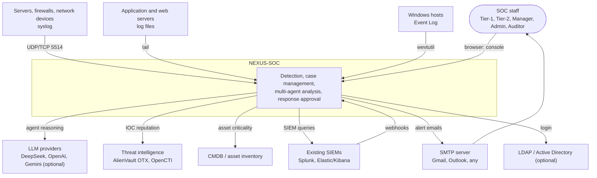

---

## 3. Containers and runtime processes

NEXUS-SOC runs as one Django codebase started in several **independent processes**. Each
process can be restarted or scaled on its own, and they talk only through PostgreSQL and Redis.

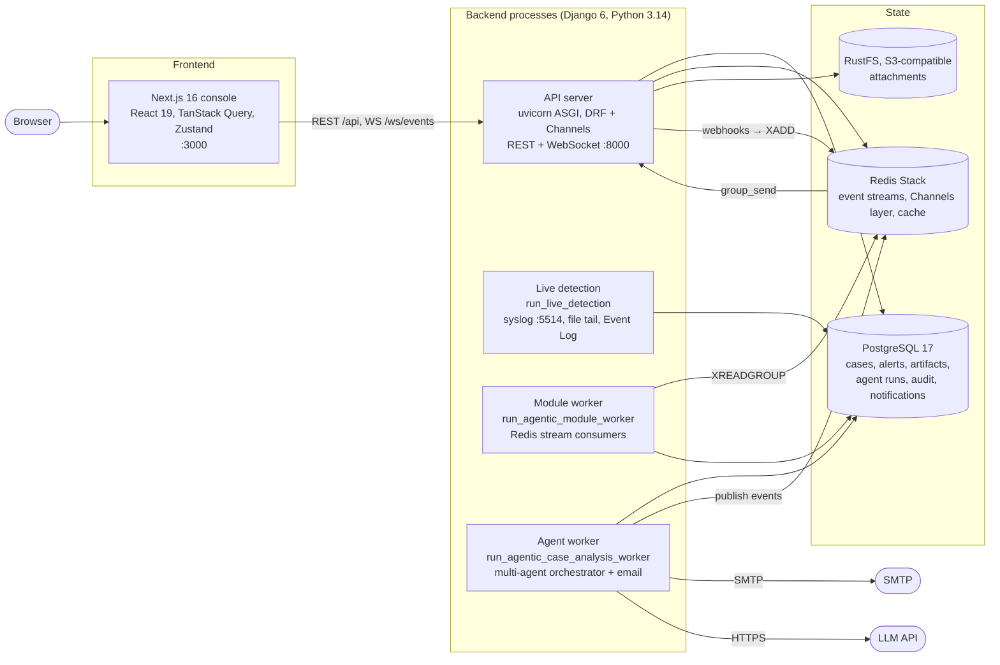

| Process | Command | Responsibility | Scales by |
|---|---|---|---|
| API server | `uvicorn soc.asgi:application` | REST API, JWT auth, RBAC, WebSocket push, webhooks | More replicas behind a load balancer |
| Agent worker | `manage.py run_agentic_case_analysis_worker` | Claims queued `CaseAnalysisJob`s, runs the agent team, auto-escalates, sends emails | More workers (jobs are claimed under row locks) |
| Module worker | `manage.py run_agentic_module_worker` | Consumes Redis streams from webhooks and runs detection modules | Consumer-group members |
| Live detection | `manage.py run_live_detection` | Receives or tails raw logs, runs the real-time rule engine, opens alerts and cases | One per log collector; shard sources by host |
| Frontend | `next start` / `npm run dev` | Role-based console | Stateless replicas |

---

## 4. Ingestion: two ways in, one pipeline

There are two ways for security data to enter the system:

- **Fed:** existing tools push alerts in. This includes Splunk/Kibana webhooks, the agent API, demo scenarios and seed data.
- **Live:** NEXUS-SOC reads raw logs itself and detects attacks.

Both converge on one function, `create_alert_with_context()`. Every alert therefore gets the
same case correlation, artifact extraction, agent analysis and notifications.

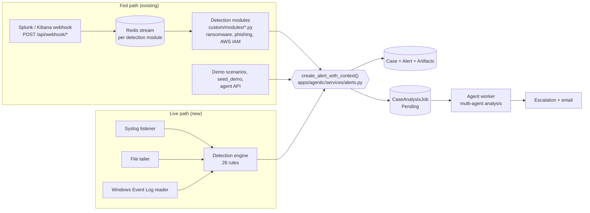

What `create_alert_with_context()` does, inside one database transaction:

1. Takes a PostgreSQL advisory lock on the `correlation_uid`, so concurrent producers can't create duplicate cases.
2. Finds the open case with that `correlation_uid`, or creates one.
3. Saves the `Alert`, then de-duplicates and links its `Artifact`s (IPs, hosts, users, commands and more).
4. Queues a `CaseAnalysisJob`, unless the case already has a pending one or agent auto-run is switched off.

---

## 5. Live detection engine

Code: `backend/apps/livedetect/`

| Module | Role |
|---|---|
| `events.py` | `LogEvent` dataclass and parsers: RFC 3164, RFC 5424 and ISO syslog; nginx/Apache combined access logs; JSON lines (ECS-style); Windows Event XML |
| `sources.py` | `SyslogSource` (UDP + TCP, newline or RFC 6587 octet framing), `FileTailSource` (globs, rotation, truncation), `WindowsEventLogSource` (`wevtutil` polling by `EventRecordID`) |
| `rules.py` | Declarative `Rule` definitions plus matcher helpers (`regex`, `http`, `windows_event`) |
| `engine.py` | `DetectionEngine`: sliding windows, distinct counting, sequence correlation, cooldown; `create_detection_alert()` |
| `management/commands/run_live_detection.py` | Process entry point: starts the sources, runs the engine loop, handles shutdown |

### 5.1 Internal pipeline

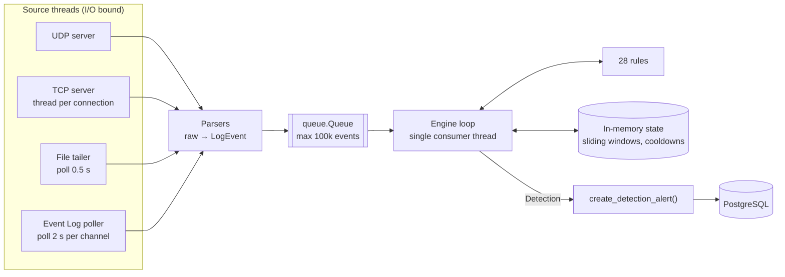

Producers are many I/O-bound threads. There is one consumer, the engine, so the rule state
needs no locks and detections are produced in a deterministic order.

### 5.2 The normalised event

```text
LogEvent
  source     "syslog" | "file" | "windows"
  timestamp  timezone-aware datetime (RFC 3164 year inferred, rolled back across New Year)
  host       reporting host (falls back to the syslog peer IP)
  program    sshd, sudo, kernel, http, Microsoft-Windows-Security-Auditing ...
  channel    "udp:10.0.0.5", "/var/log/auth.log", "Security" ...
  event_id   Windows EventID, or null
  message    text the rules match against
  fields     extracted fields: src_ip, user, target_user, command, url, decoded_url, status,
             user_agent, record_id, logon_type, service, task, threat, ...
  raw        original line or XML (truncated)
```

### 5.3 Rule evaluation algorithm

For every event, every rule whose `sources` filter allows it is evaluated:

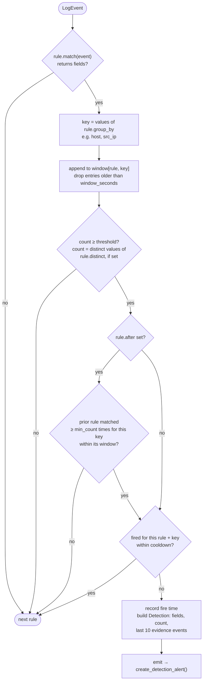

Key properties:

- **Threshold rules** (for example 5 failed SSH logins in 120 s) use a per-key `deque` of timestamps. Pruning costs O(expired entries).
- **Distinct counting** (for example 15 different destination ports in 60 s) counts unique values of one field instead of raw events.
- **Sequence correlation** (`After`): a rule can require that another rule matched recently for the same key. Example: a successful SSH login from an IP with at least 3 failures in the last 15 minutes. Every match is recorded before the threshold check, so history is available even when the earlier rule never fired.
- **Cooldown** (default 600 s, `LIVE_DETECTION_COOLDOWN_SECONDS`) suppresses repeated detections for the same rule and key.
- **Garbage collection** every 2,000 events drops windows and cooldowns older than the longest window, so memory stays bounded by the number of active keys.
- **Event time, not wall-clock time,** drives the windows. Replaying old files with `--from-start` therefore behaves exactly as live traffic would.
- A rule that raises an exception is logged and skipped. One faulty rule can't stop the engine.

### 5.4 Source behaviour

| Source | Transport and format | Start position | Failure handling |
|---|---|---|---|
| Syslog | UDP and TCP on `LIVE_SYSLOG_PORT` (5514); newline-framed or RFC 6587 octet-counted; RFC 3164/5424/ISO | Live only | Bind errors abort start-up with a clear message; a malformed line is kept as a plain-message event |
| Files | Paths or globs; plain syslog, access logs, JSON lines auto-detected per line | End of file (or `--from-start`); files created later are read from the beginning | Rotation (inode change) and truncation (size shrink) trigger a reopen; partial lines are buffered; new files are discovered every 5 s |
| Windows Event Log | `wevtutil qe <channel> /q:*[System[(EventRecordID>N)]]`; Security, System, PowerShell/Operational, Defender/Operational | Latest record (or `--from-start`) | A channel that can't be read (for example Security without Administrator) is skipped with a hint; the others continue |

---

## 6. Detection rule catalogue

There are 28 rules, listed by `python manage.py run_live_detection --list-rules`. Threshold
values are `count / window`; "seq" means sequence correlation.

### Linux, SSH and network

| Rule ID | Detects | Logic | Severity | MITRE ATT&CK |
|---|---|---|---|---|
| `linux.ssh_bruteforce` | Many failed SSH logins from one IP | ≥ 5 / 120 s per host + IP | High | T1110.001 Password Guessing |
| `linux.ssh_login_after_bruteforce` | Successful SSH login from a brute-forcing IP | seq: ≥ 3 brute-force matches / 900 s | Critical | T1078 Valid Accounts |
| `linux.sudo_failures` | Repeated sudo authentication failures | ≥ 3 / 300 s per host + user | Medium | T1548.003 Sudo and Sudo Caching |
| `linux.user_created` | New local account (`useradd`) | single event | Medium | T1136.001 Local Account |
| `linux.privileged_group_add` | User added to sudo, wheel, admin, root or docker | single event | High | T1098 Account Manipulation |
| `network.port_scan` | One source hits many ports (iptables/UFW logs) | ≥ 15 distinct `DPT` / 60 s | Medium | T1046 Network Service Discovery |

### Web (access logs)

| Rule ID | Detects | Logic | Severity | MITRE ATT&CK |
|---|---|---|---|---|
| `web.sql_injection` | `UNION SELECT`, `' OR '1'='1`, `sleep()`, `information_schema` ... | URL decoded twice, then regex | High | T1190 Exploit Public-Facing Application |
| `web.xss` | `<script`, `onerror=`, `javascript:`, `document.cookie` ... | regex | Medium | T1190 |
| `web.path_traversal` | `../`, `/etc/passwd`, `win.ini` ... | regex | High | T1190 |
| `web.command_injection` | `; cat`, `$(...)`, `${jndi:` (Log4Shell), also in the User-Agent | regex | Critical | T1190 |
| `web.scanner_user_agent` | sqlmap, nikto, nmap, nuclei, gobuster, hydra ... | User-Agent regex | Medium | T1595.002 Vulnerability Scanning |
| `web.directory_bruteforce` | Bursts of 404 responses from one IP | ≥ 20 / 60 s per IP | Medium | T1595.003 Wordlist Scanning |

### Windows Event Log

| Rule ID | Event IDs | Logic | Severity | MITRE ATT&CK |
|---|---|---|---|---|
| `windows.failed_logon_bruteforce` | 4625 | ≥ 5 / 120 s per host + source IP | High | T1110 Brute Force |
| `windows.logon_after_bruteforce` | 4624 (logon types 3, 8, 10) | seq: ≥ 3 failures / 900 s | Critical | T1078 Valid Accounts |
| `windows.user_created` | 4720 | single event | Medium | T1136.001 Local Account |
| `windows.admin_group_add` | 4728, 4732, 4756 | group name matches an admin group | High | T1098 Account Manipulation |
| `windows.audit_log_cleared` | 1102, 104 | single event | Critical | T1070.001 Clear Windows Event Logs |
| `windows.service_installed` | 7045 | single event | Medium | T1543.003 Windows Service |
| `windows.scheduled_task_created` | 4698 | single event | Medium | T1053.005 Scheduled Task |
| `windows.defender_malware` | 1116, 1117 | single event | High | T1204 User Execution |

### Suspicious commands (any source: shell/auditd logs, 4688 command lines, PowerShell 4104 script blocks, 7045 image paths)

| Rule ID | Examples | Severity | MITRE ATT&CK |
|---|---|---|---|
| `command.reverse_shell` | `bash -i >& /dev/tcp/…`, `nc -e /bin/sh`, `mkfifo /tmp/…` | Critical | T1059.004 Unix Shell |
| `command.download_exec` | `curl … \| sh`, `IEX (New-Object Net.WebClient)`, `DownloadString(` | High | T1105 Ingress Tool Transfer |
| `command.encoded_powershell` | `powershell -enc <base64>` | High | T1059.001 PowerShell |
| `command.shadow_copy_delete` | `vssadmin delete shadows`, `wmic shadowcopy delete`, `bcdedit … recoveryenabled no` | Critical | T1490 Inhibit System Recovery |
| `command.credential_dumping` | `mimikatz`, `sekurlsa::`, `procdump … lsass`, `reg save hklm\sam` | Critical | T1003 OS Credential Dumping |
| `command.lolbin_download` | `certutil -urlcache -f`, `bitsadmin /transfer`, `mshta http…` | High | T1218 System Binary Proxy Execution |
| `command.log_tampering` | `rm -rf /var/log`, `history -c`, `wevtutil cl`, `Clear-EventLog` | High | T1070 Indicator Removal |
| `command.defender_disabled` | `Set-MpPreference -Disable… $true`, `systemctl stop auditd`, `setenforce 0` | High | T1562.001 Disable or Modify Tools |

### Adding a rule

Rules are plain data. A new detection is usually one entry in `rules.py`:

```python
Rule(
    id="linux.cron_persistence",
    title="Crontab modified by {actor_user} on {host}",
    description="A user's crontab was replaced, a common persistence mechanism.",
    severity=Severity.MEDIUM,
    tactic=AlertTactic.PERSISTENCE,
    technique="T1053.003 - Cron",
    category=ProductCategory.SIEM,
    match=regex(r"\((?P<actor_user>[\w.-]+)\) REPLACE \(", programs=("crontab",)),
    group_by=("host", "actor_user"),
    tags=("cron", "persistence"),
)
```

Named regex groups become fields. Fields with well-known names (`src_ip`, `host`, `user`,
`command`, `url` ...) are turned into artifacts automatically. Add a positive and a benign case
to `apps/livedetect/tests.py`.

---

## 7. Alert, case and correlation model

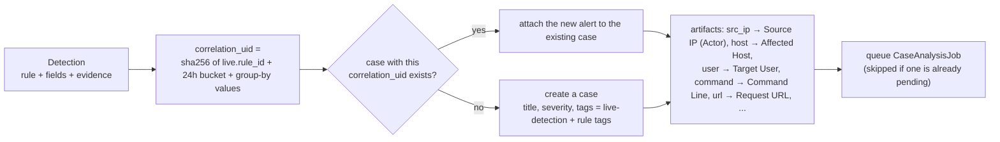

- **One incident, one case.** Repeats of the same rule and key within the same 24-hour bucket join one case instead of creating new ones.
- **Raw evidence is kept.** `alert.raw_data` stores the triggering event plus the last 10 matching events. `alert.unmapped` stores the extracted fields and the match count.
- **MITRE mapping and mitigation advice** are stored on every alert. The agents reuse them in their reasoning and reports.
- **Free text stays clean.** Source file paths and peers go in `data_sources`, not in the description, so they can't influence the agents' keyword heuristics.

---

## 8. Multi-agent analysis

Code: `backend/apps/agentic/multiagent/`

### 8.1 Agents

| Agent | Purpose | Tools |
|---|---|---|
| **Supervisor** | Chooses the next specialist and explains why; bounded by guardrails | (none) |
| **Triage** | Classifies the case, scores severity and priority, screens for false positives and duplicates | `cases.related`, `knowledge.search` |
| **Threat Intel** | Checks the reputation of IOCs (IPs, domains, URLs, hashes, emails) | `threat_intel.lookup` (AlienVault OTX, OpenCTI, mock) |
| **Asset & Identity** | Judges business criticality, ownership and blast radius | `cmdb.lookup` |
| **Investigation** | Searches logs around the entities, rebuilds the timeline and attack chain, maps to ATT&CK | `siem.search` (Splunk, Elastic) |
| **Response** | Builds a containment plan and proposes actions | `actions.propose` |
| **Reporting** | Writes the final verdict, executive summary and technical report | (none) |

### 8.2 Supervisor routing (guardrailed state machine)

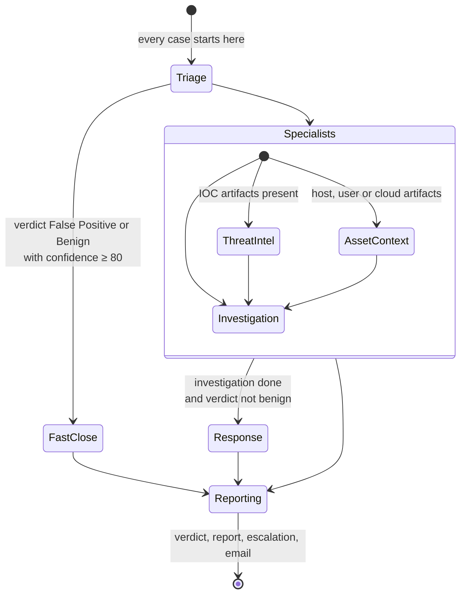

- `allowed_next()` computes the **legal** moves from the current state. The LLM picks one of them and gives a reason.
- If the LLM is offline, picks an illegal move or fails, the deterministic `policy_next()` decides. The override is recorded in the decision trail.
- A step budget (runtime setting `agent_max_steps`, minimum 4) guarantees termination. With one step left, Reporting is forced.

### 8.3 LLM gateway

| Mode | Behaviour |
|---|---|
| `auto` (default) | Uses the configured provider. Falls back to the built-in offline engine when the provider is unreachable or a call fails. |
| `online` | Always uses the LLM; errors stop the run (for model evaluation). |
| `offline` | Deterministic heuristics only; no network, no API key. |

Every step records the model, mode, prompt and output, tool calls, tokens and latency in `AgentStep`.

### 8.4 After the run

When a run completes, the orchestrator does the following in order:

1. Stores the verdict, severity, confidence, summary and report on the `AgentRun`, and the AI fields on the `Case`.
2. **Auto-escalates** to Tier 2 when the verdict is True Positive and the severity is High or Critical.
3. **Emails** the SOC team if the notification policy matches ([§10](#10-alert-email-notifications)). Failures are logged and never fail the run.
4. Publishes `agent.run.completed` on the WebSocket feed.

---

## 9. Response actions and human approval

Agents never execute containment directly. They create `ActionProposal`s, and **policy**, not
the LLM, assigns each one a risk tier.

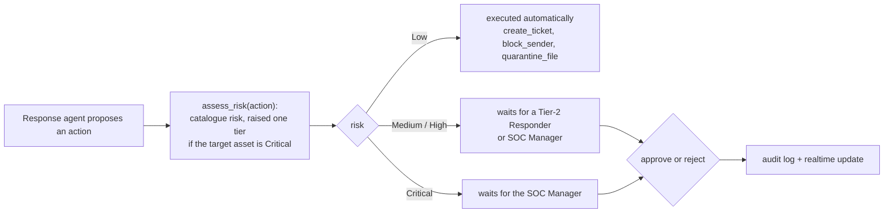

| Risk | Actions | Approver |
|---|---|---|
| Low | Open ticket, block email sender, quarantine file hash | None (auto) |
| Medium | Block IP, block domain, purge email, reset credentials, revoke sessions | Tier-2 Responder or SOC Manager |
| High | Isolate host, disable user, revoke IAM policy | Tier-2 Responder or SOC Manager |
| Critical | Any High action on a Critical asset | SOC Manager |

Admins can approve anything.

---

## 10. Alert email notifications

Code: `backend/apps/notifications/`

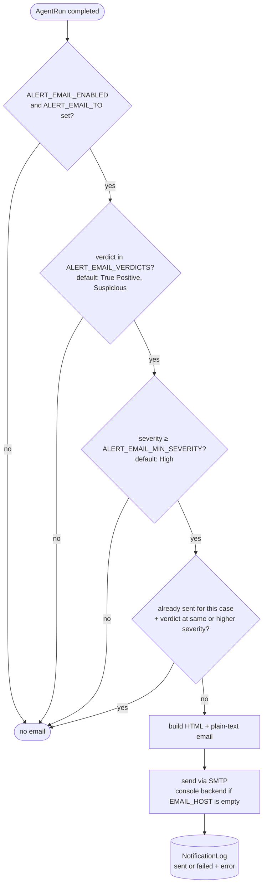

- **De-duplication.** A case is emailed once per verdict. It is emailed again only when the severity rises, for example from High to Critical. Failed attempts don't block a retry.
- **Content:** verdict, severity, confidence, detection rule, MITRE tactic and technique, first and last seen, AI summary, affected assets, IOCs, recommended actions, and a button linking to `SOC_CONSOLE_URL/cases/<id>`. All values are HTML-escaped.
- **Isolation.** SMTP errors are recorded in `notification_logs.error` and logged. They never break agent analysis.
- **Check the setup:** `python manage.py send_test_email [--to address]`.

---

## 11. End-to-end sequence

An SSH brute force followed by a successful login, as tested in the live environment:

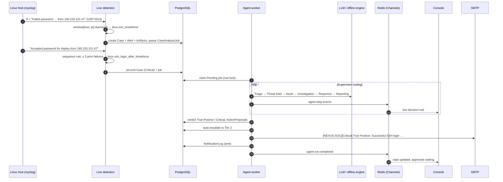

---

## 12. Data model

The core entities, simplified:

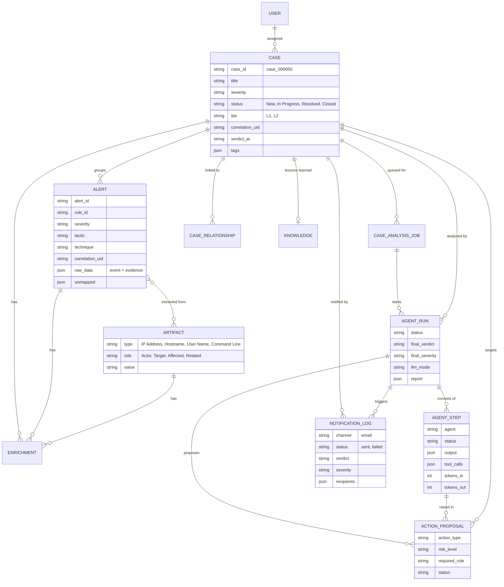

Comments, attachments and the audit log attach to any record through Django generic relations.
`AuditLog` records who changed what, and when.

---

## 13. Console, realtime and access control

### 13.1 Console areas (Next.js App Router)

| Route | For | Purpose |
|---|---|---|
| `/queue`, `/alerts` | Tier-1 | Alert queue, AI triage review, escalate |
| `/responder`, `/approvals` | Tier-2 | Escalated cases, approve or reject containment |
| `/cases/[id]` | All | Case detail: alerts, artifacts, live agent decision trail, comments |
| `/runs`, `/agents` | All | Agent runs, agent catalogue, LLM status |
| `/reports` | All | Incident reports |
| `/manager` | SOC Manager | KPIs, team workload |
| `/knowledge` | Analysts | Knowledge base used by Triage (for example whitelists) |
| `/audit` | Auditor | Audit log |
| `/admin` | Admin | Users and roles, LLM providers, integrations, runtime mode |

### 13.2 Realtime

The browser keeps one WebSocket open to `/ws/events/`, authenticated with the JWT. Each user
is subscribed to:

- their personal inbox group (mentions, assignments),
- the agents feed (`agent.step`, `agent.run.completed`, action proposals),
- the comment threads of any record they have open, subject to a permission check.

Workers publish through the Redis Channels layer, so any API replica can deliver the event.

### 13.3 Roles (RBAC)

`apps/accounts/rbac.py` is the single source of truth. The API enforces it on every endpoint,
and the console receives the same permission list from `/api/auth/me/` to build its menus.

| Capability | Tier-1 | Tier-2 | Manager | Admin | Auditor |
|---|:-:|:-:|:-:|:-:|:-:|
| View dashboard, cases, alerts, agent runs, proposals, reports | ✓ | ✓ | ✓ | ✓ | ✓ |
| Edit cases, comment | ✓ | ✓ | ✓ | ✓ | |
| Escalate to Tier-2 | ✓ | ✓ | ✓ | ✓ | |
| Run agents | ✓ | ✓ | ✓ | ✓ | |
| Close incidents | | ✓ | ✓ | ✓ | |
| Write knowledge base | | ✓ | ✓ | ✓ | |
| Approve Medium/High actions | | ✓ | ✓ | ✓ | |
| Approve Critical actions | | | ✓ | ✓ | |
| Delete records | | | ✓ | ✓ | |
| Team dashboard, audit log | | | ✓ | ✓ | ✓ |
| Users, LLM providers, settings | | | | ✓ | |

---

## 14. Deployment

### 14.1 Docker Compose (`docker-compose.yml`)

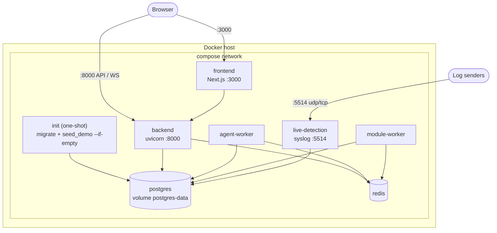

`init` must finish successfully before the backend, workers and live detection start. All
backend services share one image and one `.env`. The Windows Event Log source isn't available
inside Linux containers; run `run_live_detection` natively on Windows hosts for that.

### 14.2 Local development (Windows)

`scripts/start-dev.ps1`:

1. Creates the virtualenv and `.env` if they're missing.
2. Starts PostgreSQL and Redis from `development/docker/compose.yaml`.
3. Migrates and seeds the database.
4. Opens four windows: API, agent worker, frontend and live detection.

If a native PostgreSQL already uses port 5432, set `POSTGRES_HOST_PORT=5433` in
`development/docker/.env` and `POSTGRES_PORT=5433` in `backend/.env`.

---

## 15. Latency and throughput

The figures below were measured on the development machine (one Python 3.14 thread):

| Stage | Cost | Notes |
|---|---|---|
| Parse one log line | ~23 µs | syslog or access log |
| Evaluate all 28 rules | ~30–35 µs | per event |
| **Engine throughput** | **~17,000–19,000 events/s per process** | parse + rules |
| Syslog arrival → detection | < 10 ms | push-based |
| File line → detection | ≤ 0.5 s | poll interval |
| Windows event → detection | ≤ 2 s | `wevtutil` poll interval |
| Detection → case in DB | milliseconds | one transaction |
| Case → agent verdict (offline engine) | seconds | includes `AGENT_OFFLINE_STEP_DELAY_MS` (700 ms per step) for demos; set to 0 for full speed |
| Case → agent verdict (LLM) | ~10–60 s | depends on provider and number of agents routed |

**Detection latency is dominated by polling, not computation.** The main levers are push-based
Windows subscriptions (`EvtSubscribe`) and a shorter file poll interval. Agent analysis runs
asynchronously, after the alert is already visible in the console, so LLM latency never delays
detection.

**Scaling past one process:** run more live-detection processes, each owning a subset of
sources or hosts. Threshold state is per key, so sharding by host keeps every rule correct.

---

## 16. Configuration reference

All settings are environment variables in `backend/.env` (local) or `.env` (Docker).

### Alert emails

| Variable | Default | Meaning |
|---|---|---|
| `EMAIL_HOST` | *(empty)* | SMTP server, for example `smtp.gmail.com`. Empty = print emails to the console. |
| `EMAIL_PORT` | `587` | 587 = STARTTLS, 465 = SSL (detected automatically) |
| `EMAIL_HOST_USER`, `EMAIL_HOST_PASSWORD` | | SMTP login. For Gmail use an App Password. |
| `EMAIL_USE_TLS`, `EMAIL_USE_SSL` | derived from the port | Override if needed |
| `DEFAULT_FROM_EMAIL` | `NEXUS-SOC <EMAIL_HOST_USER>` | Sender |
| `ALERT_EMAIL_ENABLED` | `true` | Master switch |
| `ALERT_EMAIL_TO` | *(empty)* | Comma-separated recipients; empty = no emails |
| `ALERT_EMAIL_MIN_SEVERITY` | `High` | Low, Medium, High or Critical |
| `ALERT_EMAIL_VERDICTS` | `True Positive,Suspicious` | Verdicts that trigger an email |
| `SOC_CONSOLE_URL` | `http://localhost:3000` | Base URL for the "Open case" link |

### Live detection

| Variable | Default | Meaning |
|---|---|---|
| `LIVE_SYSLOG_HOST` | `0.0.0.0` | Listener bind address |
| `LIVE_SYSLOG_PORT` | `5514` | UDP and TCP port; `0` disables syslog |
| `LIVE_TAIL_FILES` | *(empty)* | Comma-separated paths or globs to follow |
| `LIVE_WINDOWS_EVENTLOG` | `auto` | `auto` (on when running on Windows), `on` or `off` |
| `LIVE_WINDOWS_CHANNELS` | Security, System, PowerShell, Defender | Comma-separated log names |
| `LIVE_DETECTION_COOLDOWN_SECONDS` | `600` | Suppression window per rule and key |

Command-line flags override these: `--syslog-port`, `--no-syslog-tcp`, `--tail` (repeatable),
`--windows`, `--windows-channels`, `--from-start`, `--cooldown`, `--list-rules`.

---

## 17. Operations runbook

| Task | Command (from `backend/`) |
|---|---|
| List detection rules | `python manage.py run_live_detection --list-rules` |
| Start live detection | `python manage.py run_live_detection --tail /var/log/auth.log` |
| Replay an old log file through the rules | `python manage.py run_live_detection --syslog-port 0 --windows off --tail old.log --from-start` |
| Check email delivery | `python manage.py send_test_email --to you@example.com` |
| Start the agent worker | `python manage.py run_agentic_case_analysis_worker --interval 1` |
| Rebuild demo history | `python manage.py seed_demo --reset` |
| Run the tests | `python manage.py test` |

**Forwarding logs from Linux to NEXUS-SOC.** Create `/etc/rsyslog.d/90-nexus.conf` containing
`*.* @@nexus-host:5514` (`@@` = TCP, `@` = UDP), then run `systemctl restart rsyslog`.

**Troubleshooting**

| Symptom | Cause and fix |
|---|---|
| `Skipping Windows log Security: Access is denied` | Run the live-detection window as Administrator. |
| `Cannot listen for syslog on port 5514` | Another process uses the port. Choose another with `--syslog-port`. |
| Detections appear but no emails | Check `ALERT_EMAIL_TO`, the verdict and severity policy, and `notification_logs.error`; run `send_test_email`. |
| Gmail `535 Username and Password not accepted` | Use an App Password, not the account password; 2-Step Verification must be on. |
| Same attack appears only once | Expected: the cooldown and 24-hour case correlation apply. Lower `--cooldown` for testing. |

---

## 18. Testing

The backend has 86 tests, run with `python manage.py test`:

| Suite | Covers |
|---|---|
| `apps.livedetect` (21) | Parsers (RFC 3164/5424, ISO, access log, JSON, Windows XML, garbage input); thresholds, windows, cooldown, distinct counting, sequence correlation; web, Windows and command rules; benign traffic stays quiet; alert, case, artifact and job creation; real UDP/TCP syslog sockets; file tailing with partial lines and truncation |
| `apps.notifications` (7) | Policy; rich email content and links; de-duplication and severity upgrade; HTML escaping; no recipients; SMTP failure then retry; email sent at the end of a real offline agent run |
| `apps.agentic` and others | Orchestrator, supervisor guardrails, LLM fallback, action risk and approval roles, RBAC, webhooks, audit, attachments, SIEM integration |

---

## 19. Design decisions

| Decision | Alternatives considered | Why |
|---|---|---|
| One shared entry point (`create_alert_with_context`) for fed and live alerts | Separate pipelines | Identical correlation, artifacts, agent analysis and emails, whatever the source |
| Rule engine inside its own process, state in memory | Rules in SQL; a stream processor (Flink, Kafka Streams) | Microsecond evaluation, no new infrastructure; state is cheap to rebuild after a restart (at most one window of history is lost) |
| Single-consumer engine with multi-threaded sources | Locking shared state | No locks, deterministic, still ~18k events/s; scale out by sharding sources |
| Event time drives windows | Wall-clock time | Correct for replayed files and delayed senders |
| `wevtutil` polling for Windows | `pywin32` `EvtSubscribe` | No native dependency; ≤ 2 s latency is acceptable for now (see roadmap) |
| Email after the agent verdict, not on raw detection | Email every detection | Far less noise; the email already contains the AI assessment and actions |
| Policy-assigned risk tiers for actions | LLM-assigned risk | Safety must not depend on model output |
| Guardrailed supervisor (legal moves + deterministic fallback) | Free-form LLM routing | Termination and ordering guarantees; still auditable when the LLM is wrong |
| Offline agent engine | LLM required | Works air-gapped and in demos; graceful degradation in `auto` mode |
| Whole-word false-positive hints in triage | Substring matching | Substring matching let words like "latest" or "contest" in logs mark real attacks benign |

---

## 20. Known limitations and roadmap

**Limitations**

- Detection is signature, threshold and correlation based. Attacks that match no rule, for example quiet use of stolen credentials, are not detected.
- Engine state is in memory. A restart forgets open windows, so a brute force in progress has to reach its threshold again.
- Reading the Windows Security log needs Administrator rights, and the reader polls every 2 seconds.
- The syslog listener has no TLS and no sender authentication. Expose it only on trusted networks.
- Response connectors (firewall, EDR, identity provider) are simulated.
- Email is the only notification channel.

**Roadmap (suggested order)**

1. **Behavioural baselines (UEBA-lite):** first-seen IP or country per user, unusual login hour, failure and volume spikes, new processes per host. Statistical, explainable, no training data needed, microseconds per event.
2. **Agent evaluation with a real LLM** on live detections: verdict accuracy, time to verdict, auto-closed false positives.
3. **Analyst feedback loop:** verdict overrides become labels that tune thresholds and agent prompts.
4. **Lower latency:** push-based Windows subscriptions and shorter file polling.
5. **More channels:** Slack, Microsoft Teams and webhook notifications; per-role recipient lists configured in the UI.
6. **Hardening:** syslog over TLS (RFC 5425), allow-lists of senders, persistent rule state in Redis.
7. **Trained models (when real data exists):** web payload and command-line classifiers kept within a strict per-event latency budget.
